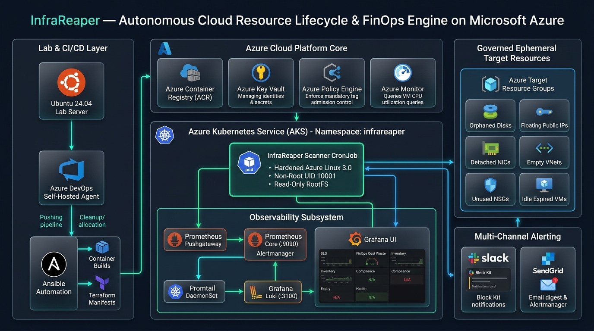

# InfraReaper: Autonomous Cloud Resource Lifecycle, Governance & FinOps Engine on Microsoft Azure

> **Document Type:** End-to-End Enterprise Project Documentation & Architecture Specification  
> **Document Version:** 2.0.0 (Production Release)  
> **Classification:** Technical Architecture & Engineering Operations Guide  
> **Target Audience:** Lead Cloud Architects, DevOps/SRE Engineers, FinOps Practitioners, Security Auditors  
> **Author:** Santhosh Kumar (Lead DevOps & Cloud Infrastructure Engineer)  
> **Last Updated:** November 2026  

---

## Table of Contents

1. [Executive Summary & FinOps Value Proposition](#1-executive-summary--finops-value-proposition)
   - 1.1 The Enterprise Cloud Waste Crisis
   - 1.2 The InfraReaper Solution
   - 1.3 Measurable FinOps ROI & Waste Avoidance
2. [End-to-End System Architecture](#2-end-to-end-system-architecture)
   - 2.1 Global Architecture & Component Interaction
   - 2.2 Infrastructure Demarcation & Blast Radius Isolation
   - 2.3 Detailed Execution Sequence (Scan $\to$ Evaluate $\to$ Deallocate $\to$ Cleanup $\to$ Notify $\to$ Telemetry)
3. [Governance & Lifecycle Engine](#3-governance--lifecycle-engine)
   - 3.1 Multi-Resource Discovery Engine
   - 3.2 Tag Governance & ARM Policy Enforcement (`Deny` Gate)
   - 3.3 Expiration Calculations, 48-Hour Grace Period & Max 30-Day Lease Cap
   - 3.4 Idle VM Detection & Automated Deallocation (FinOps Cost Optimization)
   - 3.5 Orphan Detection & Multi-Pass Cascading Purge
   - 3.6 Safety Guards: Dry-Run Mode, Protected Resource Whitelists & Resource Locks
4. [Infrastructure as Code (Terraform & Ansible)](#4-infrastructure-as-code-terraform--ansible)
   - 4.1 Modular Terraform Architecture
   - 4.2 State Backend & Self-Healing Policy Drift Reconciliation
   - 4.3 Ansible Control Node & Idempotent Lab Provisioning
5. [Containerization & DevSecOps Hardening](#5-containerization--devsecops-hardening)
   - 5.1 Distroless & Azure Linux 3.0 Container Architecture
   - 5.2 Non-Root Execution & Read-Only Root Filesystem
   - 5.3 Automated Vulnerability Scanning (Trivy 0-CVE Policy & Baseline)
6. [Kubernetes Workload & Kustomize Deployment](#6-kubernetes-workload--kustomize-deployment)
   - 6.1 Kubernetes Batch CronJob Architecture
   - 6.2 Pod Security Context & Zero-Ingress NetworkPolicy
   - 6.3 Environment Separation via Kustomize (`dev` vs. `prod`)
7. [Enterprise CI/CD Automation (Azure DevOps)](#7-enterprise-cicd-automation-azure-devops)
   - 7.1 Pipeline Architecture & Self-Hosted Runner Integration
   - 7.2 Six-Stage Pipeline Deep-Dive
   - 7.3 Automated Live Smoke Testing & Synthetic Verification
8. [Full-Stack Observability & Telemetry](#8-full-stack-observability--telemetry)
   - 8.1 Prometheus Metrics Pipeline & Pushgateway
   - 8.2 Comprehensive Metrics Dictionary
   - 8.3 Grafana 6-Dashboard Production Suite
   - 8.4 Centralized Logging with Promtail & Loki
9. [Multi-Channel Notification & Alert Management](#9-multi-channel-notification--alert-management)
   - 9.1 Slack Block Kit Interactive Status Cards
   - 9.2 SendGrid & Alertmanager Email Notifications
   - 9.3 Smart Alert Fatigue Guard (Zero-Noise Policy)
10. [Verification, Test Scenarios & Disaster Recovery](#10-verification-test-scenarios--disaster-recovery)
    - 10.1 Automated Script Unit Test Suite
    - 10.2 Scenario A: End-to-End Expired Lifecycle & Cascading Deletion
    - 10.3 Scenario B: Manual Deletion Orphan Sweep (Decoupled ARM Resolution)
    - 10.4 Standard Operating Procedures (SOPs) & Runbooks

---

## 1. Executive Summary & FinOps Value Proposition

### 1.1 The Enterprise Cloud Waste Crisis
In modern multi-tenant enterprise cloud environments, rapid development velocity inevitably introduces **uncontrolled cloud sprawl**. Industry analyses reveal that **25% to 35% of enterprise cloud spend is completely wasted** on forgotten, abandoned, or improperly decommissioned assets:
- **Orphaned Managed Disks**: Disks left detached after virtual machine deletion still accrue standard gigabyte-per-month and provisioned IOPS charges indefinitely.
- **Unassociated Public IPs**: Reserved static and dynamic public IP addresses without active network interface bindings incur hourly reservation fees.
- **Abandoned Network Infrastructure**: Virtual networks (VNets) and Network Security Groups (NSGs) left behind after testing pollute subnet address spaces and complicate compliance audits.
- **Zombie / Idle Virtual Machines**: Pre-production, proof-of-concept, or developer virtual machines left running 24/7 with under 2% average CPU utilization.
- **Lease Evasion**: Developers setting arbitrary far-future expiration dates (e.g., `2099-12-31`) to bypass governance policies.

```
                              ENTERPRISE CLOUD SPEND BREAKDOWN
  ┌────────────────────────────────────────────────────────────────────────────────────────┐
  │  Active Production Workloads (65%)     │ Orphaned Storage / IPs (15%) │ Idle VMs (20%) │
  └────────────────────────────────────────────────────────────────────────────────────────┘
                                           └──────────────────┬────────────────────────────┘
                                                   FinOps Targetable Waste (~35%)
```

### 1.2 The InfraReaper Solution
**InfraReaper** is an autonomous, cloud-native lifecycle, governance, and FinOps automation engine purpose-built for Microsoft Azure. Operating as a scheduled Kubernetes workload on Azure Kubernetes Service (AKS), InfraReaper continuously audits target subscriptions, enforces mandatory tag governance, auto-caps excessive resource leases, deallocates idle compute instances, and safely purges abandoned orphan infrastructure with zero human intervention.

### 1.3 Measurable FinOps ROI & Waste Avoidance
InfraReaper transforms governance from a reactive audit exercise into an automated, proactive cost-reclamation loop:
- **Instant Compute Waste Elimination**: Auto-deallocates idle VMs (CPU < 2.0%), instantly slashing compute costs to **$0/hour** while preserving the underlying OS disk for future reactivation.
- **100% Storage & IP Leak Prevention**: Multi-pass cascading garbage collection terminates detached disks, floating public IPs, empty VNets, and unused NSGs within 48 hours of abandonment.
- **Financial Attribution**: Every discovered asset is evaluated against standard Azure retail rate cards ($USD/month) and published as real-time Prometheus gauges (`infrareaper_estimated_monthly_savings_usd`) to quantify FinOps savings for executive stakeholders.

---

## 2. End-to-End System Architecture

### 2.1 Global Architecture & Component Interaction

<p align="center">
  
</p>

InfraReaper coordinates across on-premises automation infrastructure, Azure managed PaaS services, and a hardened AKS containerized runtime:

```
┌───────────────────────────────────────────────────────────────────────────────────────────────────┐
│                                   ON-PREMISES / LAB CONTROL PLANE                                  │
│                                                                                                   │
│   ┌────────────────────────────────────────┐         ┌────────────────────────────────────────┐   │
│   │   Ansible Control Node (Ubuntu 24.04)  │────────►│ Azure DevOps Self-Hosted Agent Pool    │   │
│   │   - CIS Hardened OS Baseline           │         │ - Tools: az, terraform, kubectl, helm  │   │
│   │   - Docker Engine v27 + Trivy Scanner  │         │ - Executes azure-pipelines.yml CI/CD   │   │
│   └────────────────────────────────────────┘         └───────────────────┬────────────────────┘   │
└──────────────────────────────────────────────────────────────────────────┼────────────────────────┘
                                                                           │
                                      Build Images, Deploy Manifests, Push │ Terraform State
                                                                           ▼
┌───────────────────────────────────────────────────────────────────────────────────────────────────┐
│                                       MICROSOFT AZURE CLOUD                                       │
│                                                                                                   │
│  ┌── Core Management (infrareaper-core-rg) ────────────────────────────────────────────────────┐  │
│  │  ┌───────────────────────┐   ┌──────────────────────┐   ┌────────────────────────────────┐  │  │
│  │  │ Azure Container Reg   │   │   Azure Key Vault    │   │ Azure Storage Account          │  │  │
│  │  │ (infrareaperacrpalwa) │   │ (infrareaperkv-*)    │   │ (infrareaperstatestg - State)  │  │  │
│  │  └───────────▲───────────┘   └──────────▲───────────┘   └────────────────────────────────┘  │  │
│  │              │                          │ Key Vault Secrets Sync                             │  │
│  │              │ Image Pull               │ (SP Client Secret, Slack Webhook)                  │  │
│  │  ┌───────────┴──────────────────────────┴────────────────────────────────────────────────┐  │  │
│  │  │                      Azure Kubernetes Service (AKS) Cluster                           │  │  │
│  │  │                                                                                       │  │  │
│  │  │   Namespace: infrareaper (Isolated NetworkPolicy)                                     │  │  │
│  │  │                                                                                       │  │  │
│  │  │   ┌────────────────────────────────┐          ┌───────────────────────────────────┐   │  │  │
│  │  │   │ InfraReaper Scanner CronJob    │─────────►│ Prometheus Pushgateway            │   │  │  │
│  │  │   │ (Every 30 Mins | Non-Root Pod) │ Metrics  │ (Port 9091)                       │   │  │  │
│  │  │   └───────┬──────────────┬─────────┘          └───────────────▲───────────────────┘   │  │  │
│  │  │           │              │                                    │ Scrapes               │  │  │
│  │  │           │ Logs         │ Slack Webhook                      │ Every 15s             │  │  │
│  │  │           ▼              ▼                                    │                       │  │  │
│  │  │   ┌───────────────┐ ┌────────────────┐        ┌───────────────┴───────────────────┐   │  │  │
│  │  │   │ Promtail      │ │ Slack Channel  │        │ Prometheus Core Server            │   │  │  │
│  │  │   │ DaemonSet     │ │ (#alerts)      │        │ (Port 9090 | 15d Retention)       │   │  │  │
│  │  │   └───────┬───────┘ └────────────────┘        └───────────────┬───────────────────┘   │  │  │
│  │  │           │                                                   │                       │  │  │
│  │  │           ▼ Stream Logs                                       │ Query Metrics         │  │  │
│  │  │   ┌───────────────┐                                           ▼                       │  │  │
│  │  │   │ Loki Storage  │◄──────────────────────────────────────────┼───────────────────┐   │  │  │
│  │  │   │ (Port 3100)   │              LogQL Queries                │ Grafana UI        │   │  │  │
│  │  │   └───────────────┘                                           │ (6 Dashboards)    │   │  │  │
│  │  │                                                               └───────────────────┘   │  │  │
│  │  └───────────────────────────────────────────────────────────────────────────────────────┘  │  │
│  └─────────────────────────────────────────────────────────────────────────────────────────────┘  │
│                                            │                                                      │
│                         Service Principal  │ Scoped ARM Operations                                │
│                         Authentication     │ (Read / Deallocate / Delete)                         │
│                                            ▼                                                      │
│  ┌── Governance Target Scope (infrareaper-test-resources) ─────────────────────────────────────┐  │
│  │  - Virtual Machines (Active / Idle)    - Network Interface Cards (Attached / Orphaned)      │  │
│  │  - Managed Disks (Attached / Orphaned) - Public IP Addresses (Associated / Orphaned)        │  │
│  │  - Virtual Networks (Active / Empty)   - Network Security Groups (Bound / Unused)           │  │
│  └─────────────────────────────────────────────────────────────────────────────────────────────┘  │
└───────────────────────────────────────────────────────────────────────────────────────────────────┘
```

### 2.2 Infrastructure Demarcation & Blast Radius Isolation
InfraReaper enforces architectural separation between control infrastructure and target environments:

| Resource Group | Purpose | Access Control (RBAC) | Destruction Policy |
| :--- | :--- | :--- | :--- |
| **`infrareaper-core-rg`** | Houses AKS, ACR, Key Vault, and Log Analytics. | Scanner SP: **Zero Permissions** (Blocked). Human Ops: Contributor. | **IMMUTABLE** (Protected by ARM Resource Locks). |
| **`infrareaper-state-rg`** | Houses remote Terraform state storage account. | Scanner SP: **Zero Permissions** (Blocked). Pipeline: Contributor. | **IMMUTABLE** (Locked against deletion). |
| **`infrareaper-test-resources`** | Target subscription pool containing ephemeral dev/test workloads. | Scanner SP: **Scoped Contributor** for cleanup operations. | **MUTABLE** (Subject to automated lifecycle reaping). |
| **`NetworkWatcherRG`** | Managed Azure Network Watcher topology instances. | Scanner SP: **Reader Only**. | **IMMUTABLE** (Hardcoded scanner skip list). |

### 2.3 Detailed Execution Sequence
Every execution run cycles through an automated six-stage lifecycle:

```
┌──────────────┐     ┌──────────────┐     ┌──────────────┐     ┌──────────────┐     ┌──────────────┐     ┌──────────────┐
│   Step 1:    │────►│   Step 2:    │────►│   Step 3:    │────►│   Step 4:    │────►│   Step 5:    │────►│   Step 6:    │
│  Discovery   │     │  Compliance  │     │   Lifecycle  │     │ Deallocation │     │   Cleanup    │     │ Notification │
│  & Inventory │     │  Evaluation  │     │  Calculation │     │  & Cascading │     │  & Audit Log │     │  & Telemetry │
└──────────────┘     └──────────────┘     └──────────────┘     └──────────────┘     └──────────────┘     └──────────────┘
```

1. **Step 1: Discovery & Inventory**: Authenticates with Azure via dedicated Service Principal, queries Azure Resource Graph and ARM APIs across target resource groups, and outputs raw inventory JSON.
2. **Step 2: Compliance Evaluation**: Validates resource tags against mandatory schemas (`Environment`, `Owner`, `Project`, `CostCenter`, `ExpireDate`), flagging non-compliant assets and generating violation severities.
3. **Step 3: Lifecycle Calculation**: Parses expiration timestamps, applies the **Max 30-Day Lease Cap**, evaluates 7-day, 72-hour, and 24-hour warning windows, and tracks the 48-hour deallocation grace period.
4. **Step 4: Idle Deallocation (FinOps)**: Inspects Azure Monitor 7-day average CPU percentage. Any VM with CPU $< 2.0\%$ is marked as `IDLE_DEALLOCATABLE` and deallocated via `az vm deallocate`.
5. **Step 5: Cleanup & Cascading Purge**: Evaluates dry-run flag (`DRY_RUN`). If disabled (`false`), purges expired VMs (cascading to OS disks and NICs), unattached disks, unassociated IPs, empty VNets, and unused NSGs.
6. **Step 6: Notification & Telemetry**: Evaluates the **Alert Fatigue Guard**. If actionable cleanups or expirations occurred, posts rich Slack Block Kit cards and dispatches email alerts. Finally, converts metrics to Prometheus exposition format and pushes to Pushgateway via HTTP.

---

## 3. Governance & Lifecycle Engine

### 3.1 Multi-Resource Discovery Engine
The discovery engine in [`scripts/scan.sh`](file:///c:/Santhosh%20work/Devops%20Project/infrareaper/scripts/scan.sh) gathers full ARM metadata for 6 core resource types:
- `Microsoft.Compute/virtualMachines`
- `Microsoft.Compute/disks`
- `Microsoft.Network/networkInterfaces`
- `Microsoft.Network/publicIPAddresses`
- `Microsoft.Network/virtualNetworks`
- `Microsoft.Network/networkSecurityGroups`

```json
{
  "id": "/subscriptions/.../resourceGroups/infrareaper-test-resources/providers/Microsoft.Compute/virtualMachines/dev-vm-01",
  "name": "dev-vm-01",
  "type": "Microsoft.Compute/virtualMachines",
  "tags": {
    "Environment": "dev",
    "Owner": "santhosh@example.com",
    "Project": "FinOps-Reaper",
    "CostCenter": "CC-1042",
    "ExpireDate": "2026-11-20"
  },
  "is_orphaned": false,
  "cpu_average_7d": 1.14,
  "is_idle": true
}
```

### 3.2 Tag Governance & ARM Policy Enforcement (`Deny` Gate)
InfraReaper enforces tag governance through a dual-layer strategy:

#### Layer 1: Preventative Admission Control (Azure Policy `Deny` Gate)
Provisioned via Terraform in [`terraform/modules/policy/main.tf`](file:///c:/Santhosh%20work/Devops%20Project/infrareaper/terraform/modules/policy/main.tf), this ARM policy intercepts resource deployment requests at the Azure API plane:
- **Mandatory Tags**: `Environment`, `Owner`, `Project`, `CostCenter`, `ExpireDate`.
- **Allowed Environments**: Enforces enum validation (`dev`, `staging`, `prod`, `lab`).
- **Date Format Enforcement**: Validates date strings against `notMatch: "####-##-##"`. Any ARM template or Azure CLI command omitting these tags or submitting malformed dates is **immediately rejected with HTTP 403 Forbidden**.

#### Layer 2: Detective Governance (InfraReaper Evaluation Engine)
In [`scripts/evaluate-policies.sh`](file:///c:/Santhosh%20work/Devops%20Project/infrareaper/scripts/evaluate-policies.sh), the scanner checks existing resources against `policies/tag-policies.yaml`:
- **Critical Severity**: Missing `Owner` or missing `ExpireDate`.
- **Warning Severity**: Missing `CostCenter` or invalid `Environment` tier.
- **Info Severity**: Recommended operational tags missing (`ApplicationName`).

### 3.3 Expiration Calculations, 48-Hour Grace Period & Max 30-Day Lease Cap
In [`scripts/check-expiry.sh`](file:///c:/Santhosh%20work/Devops%20Project/infrareaper/scripts/check-expiry.sh), lifecycle states are evaluated with strict mathematical guards:

$$\text{Days Remaining} = \frac{\text{Epoch}(\text{ExpireDate}) - \text{Epoch}(\text{Today})}{86400}$$

```
                RESOURCE LIFECYCLE TIMELINE & WARNING WINDOWS
───► Active Window ──────► 7-Day Warning ──► 72h Warning ──► 24h Warning ──► Expiry Date ──► 48h Grace Period ──► PURGE
     (Compliant)           (Slack Notice)    (Slack Notice)  (Critical)        (00:00:00)       (Deallocated)       (Deleted)
```

#### The Max 30-Day Lease Cap
To prevent developers from bypassing lifecycle governance by setting `ExpireDate=2099-12-31`, InfraReaper enforces:
```bash
MAX_LEASE_DAYS=30
MAX_ALLOWED_DATE=$(date -u -d "+${MAX_LEASE_DAYS} days" +"%Y-%m-%d")

if [[ "${EXPIRY_DATE}" > "${MAX_ALLOWED_DATE}" ]]; then
    log_warn "Resource '${RESOURCE_NAME}' specified expiry '${EXPIRY_DATE}' which exceeds maximum allowed lease (30 days)."
    EXPIRY_DATE="${MAX_ALLOWED_DATE}"
    log_info "Expiry date for '${RESOURCE_NAME}' has been capped to: ${EXPIRY_DATE}"
fi
```
Any lease requested beyond 30 days is automatically capped to 30 days, logging an audit trail and notifying the resource owner.

#### The 48-Hour Grace Period
When a resource passes its expiration date, InfraReaper does **not** delete it immediately. Instead, it enters a 48-hour deallocation grace window:
- **Hour 0 to 48**: Resource is deallocated / stopped. The owner receives high-priority Slack notifications to renew or snapshot data.
- **Hour 48+**: Resource is marked `ACTIONABLE_FOR_CLEANUP` and queued for permanent purge.

### 3.4 Idle VM Detection & Automated Deallocation
To stop idle compute billing without risking data destruction:
1. `scripts/scan.sh` queries Azure Monitor:
   ```bash
   az monitor metrics list \
     --resource "${VM_ID}" \
     --metric "Percentage CPU" \
     --interval PT1H \
     --aggregation Average
   ```
2. If the 7-day average CPU utilization is $< 2.0\%$, the VM is flagged:
   ```json
   "is_idle": true,
   "action_type": "DEALLOCATE_IDLE"
   ```
3. During execution, `scripts/cleanup.sh` triggers `az vm deallocate --name <VM> -g <RG> --no-wait`.
4. **FinOps Result**: Compute cost drops to **$0/hour**. Disks and IP reservations remain untouched. The developer can power the VM back on if needed via the portal.

### 3.5 Orphan Detection & Multi-Pass Cascading Purge

#### The Azure ARM Decoupled Architecture Challenge
When an engineer runs `az vm delete -n <vm> --yes` or deletes a VM via the Azure Portal without selecting the secondary delete boxes, Azure ARM's native behavior is **`deleteOption: "Detach"`**. 
ARM detaches the OS disk and NIC but leaves them alive. Consequently:
- The **OS Disk** sits idle, accumulating storage billing.
- The **NIC** remains active, holding onto the **Public IP** and **Virtual Network Subnet**.
- Because the NIC holds the Public IP, the Public IP cannot be deleted.
- Because the NIC is in the VNet Subnet, the Subnet cannot be deleted.
- Because the Subnet is bound to the NSG, the NSG cannot be deleted.

```
                                 AZURE ARM DEPENDENCY CHAIN
   ┌───────────────┐
   │ VirtualMachine│ (Deleted manually by user)
   └───────┬───────┘
           │ (Left orphaned)
           ▼
   ┌───────────────┐        ┌───────────────┐
   │ Managed Disk  │        │ Network Intef │
   │ (Orphaned)    │        │ (Orphaned)    │
   └───────────────┘        └───┬───────┬───┘
                                │       │ (Holds reference)
                        ┌───────▼─┐   ┌─▼─────────────┐
                        │Public IP│   │  VNet Subnet  │
                        └─────────┘   └───────┬───────┘
                                              │ (Bound to)
                                      ┌───────▼───────┐
                                      │      NSG      │
                                      └───────────────┘
```

#### InfraReaper Multi-Pass Cascading Resolution
InfraReaper handles this across two automated passes:

- **Pass 1**:
  1. Detects unattached disks (`managedBy == null`) $\to$ **Purged**.
  2. Detects unattached NICs (`virtualMachine == null`) $\to$ **Purged**.
- **Pass 2** (Next scheduled run or synthetic pass):
  1. With the NIC gone, the **Public IP** has zero IP configurations $\to$ **Purged**.
  2. With the NIC gone, the **VNet Subnet** has zero connected devices $\to$ **Purged**.
  3. With the Subnet gone, the **NSG** has zero subnet or NIC associations $\to$ **Purged**.

Result: Clean, 0-waste state reached with mathematical safety and zero dependency lockups.

### 3.6 Safety Guards: Dry-Run Mode, Protected Resource Whitelists & Resource Locks
To ensure InfraReaper can never cause catastrophic outages:
1. **Dry-Run Simulation**:
   Governed by the `DRY_RUN` environment variable (`true` in dev, `false` in prod). In dry-run mode, all deletions are simulated, generating exact log entries and Prometheus metrics (`infrareaper_cleaned_resources_total{mode="dry_run"}`) without issuing destructive ARM calls.
2. **Protected Resources Whitelist**:
   Defined in [`policies/protected-resources.yaml`](file:///c:/Santhosh%20work/Devops%20Project/infrareaper/policies/protected-resources.yaml):
   ```yaml
   protected_resource_groups:
     - "infrareaper-core-rg"
     - "infrareaper-state-rg"
     - "NetworkWatcherRG"
     - "MC_*" # Managed AKS Node Resource Groups
   ```
   Any resource matching these patterns is immediately bypassed during discovery.
3. **ARM Resource Lock Detection**:
   Before initiating any deallocation or deletion, the cleanup engine queries Azure Resource Locks:
   ```bash
   az lock list --resource "${RESOURCE_ID}" --query "[?level=='CanNotDelete' || level=='ReadOnly']"
   ```
   If a lock exists, cleanup is aborted, an audit warning is generated, and the lock is logged in `cleanup-audit.json`.

---

## 4. Infrastructure as Code (Terraform & Ansible)

### 4.1 Modular Terraform Architecture
Cloud resources are provisioned via reusable Terraform modules located under `terraform/modules/`:

```
terraform/
├── environments/
│   ├── dev/                  # Development configuration (DRY_RUN=true, B2s node pool)
│   └── prod/                 # Production configuration (DRY_RUN=false, D2s_v5 node pool)
└── modules/
    ├── acr/                  # Azure Container Registry with Admin disabled
    ├── aks/                  # Managed Kubernetes cluster with Azure CNI & Managed Identity
    ├── budget/               # Azure Cost Management budget alerts ($10, $25, $50, $75)
    ├── identity/             # Dedicated Service Principals for scanner and lab runner
    ├── keyvault/             # Azure Key Vault with RBAC authorization & purge protection
    ├── monitoring-infra/     # Log Analytics workspace and diagnostic telemetry sinks
    ├── networking/           # Virtual Network (10.0.0.0/16) and AKS system subnets
    ├── policy/               # Azure Policy definitions for mandatory tags & date checks
    ├── state-backend/        # Storage account & blob container for remote tfstate
    └── test-resources/       # Synthetic test targets (VMs, Disks, NICs, VNets, NSGs)
```

### 4.2 State Backend & Self-Healing Policy Drift Reconciliation
Remote state is locked and tracked in Azure Blob Storage with blob leasing.

#### Self-Healing Pipeline Stage
To resolve 409 Conflict errors caused by out-of-band Azure Policy creation during manual testing, `pipelines/templates/terraform-stage.yml` incorporates automated ARM-to-State reconciliation:
```bash
POLICY_EXISTS=$(az policy definition show --name "infrareaper-require-tags-dev" --query "id" -o tsv 2>/dev/null || true)
if [ -n "$POLICY_EXISTS" ]; then
    echo "Existing Azure Policy detected. Reconciling with Terraform state..."
    terraform state list | grep "module.policy.azurerm_policy_definition" || \
      terraform import module.policy.azurerm_policy_definition.require_tags "${POLICY_EXISTS}"
fi
```

### 4.3 Ansible Control Node & Idempotent Lab Provisioning
The on-premises Ubuntu 24.04 LTS control node is configured through Ansible roles (`ansible/roles/`):
- **`roles/common`**: Configures NTP time synchronization, system packages, and sysctl tuning.
- **`roles/security`**: Configures UFW firewall rules, Fail2ban intrusion prevention, and SSH key authentication.
- **`roles/docker`**: Installs Docker Engine v27, sets up the non-root daemon, and configures daemon logging limits.
- **`roles/azdo-agent`**: Automatically downloads, configures, and registers the Azure DevOps self-hosted Linux agent service (`vsts.agent.*`).

---

## 5. Containerization & DevSecOps Hardening

### 5.1 Distroless & Azure Linux 3.0 Container Architecture
The scanner image is built from Microsoft's hardened Azure Linux base (`mcr.microsoft.com/azure-cli:latest`):
- Zero unnecessary build tools (no `gcc`, `make`, or build compilers in production layers).
- Packaged with strictly required binaries: `az`, `jq`, `curl`, `bash`.

### 5.2 Non-Root Execution & Read-Only Root Filesystem
In accordance with CIS Docker and Kubernetes Benchmarks:
- Executes under dedicated unprivileged user `infrareaper` (`UID: 10001`, `GID: 10001`).
- The root filesystem is mounted strictly **Read-Only** (`readOnlyRootFilesystem: true`).
- All Linux capabilities are dropped (`capabilities: drop: ["ALL"]`).
- Privilege escalation is forbidden (`allowPrivilegeEscalation: false`).
- Temporary runtime data and Azure CLI caches write strictly to ephemeral `emptyDir` scratch disks mounted at `/tmp` and `/home/infrareaper/.azure`.

### 5.3 Automated Vulnerability Scanning (Trivy 0-CVE Policy & Baseline)
In Stage 2 and Stage 3 of CI/CD, **Aquasec Trivy** scans the Docker image, filesystems, and IaC manifests:
```bash
trivy image --exit-code 1 --severity CRITICAL,HIGH infrareaperacrpalwa.azurecr.io/infrareaper:$(Build.BuildId)
```
- **Strict 0-CVE Policy**: The pipeline fails if any unmitigated Critical or High vulnerabilities are detected.
- **Audited Suppression Tracking**: Upstream base image dependencies (e.g. `CVE-2026-118669` in bundled CLI virtualenv) are threat-modeled, justified, and tracked in `.trivyignore`.

---

## 6. Kubernetes Workload & Kustomize Deployment

### 6.1 Kubernetes Batch CronJob Architecture
Located in [`kubernetes/base/cronjob.yaml`](file:///c:/Santhosh%20work/Devops%20Project/infrareaper/kubernetes/base/cronjob.yaml):
- **Schedule**: `*/30 * * * *` (Executes every 30 minutes).
- **Concurrency Policy**: `Forbid` (Prevents overlapping scan runs if a scan takes longer than expected).
- **Restart Policy**: `Never` (Ensures failed jobs do not loop continuously; errors are captured for alerting).
- **Backoff Limit**: `1` (Fails fast to alert on persistent issues).

### 6.2 Pod Security Context & Zero-Ingress NetworkPolicy
Strict network sandboxing is enforced via [`kubernetes/base/networkpolicy.yaml`](file:///c:/Santhosh%20work/Devops%20Project/infrareaper/kubernetes/base/networkpolicy.yaml):

```yaml
apiVersion: networking.k8s.io/v1
kind: NetworkPolicy
metadata:
  name: infrareaper-scanner-netpol
  namespace: infrareaper
spec:
  podSelector:
    matchLabels:
      app: infrareaper-scanner
  policyTypes:
    - Ingress
    - Egress
  ingress: [] # 100% BLOCKED. Zero listening ports.
  egress:
    - to:
        - namespaceSelector: {}
          podSelector:
            matchLabels:
              k8s-app: kube-dns
      ports:
        - protocol: UDP
          port: 53
    - to:
        - podSelector:
            matchLabels:
              app: prometheus-pushgateway
      ports:
        - protocol: TCP
          port: 9091
    - to:
        - ipBlock:
            cidr: 0.0.0.0/0
            except:
              - 10.0.0.0/8
              - 172.16.0.0/12
              - 192.168.0.0/16
      ports:
        - protocol: TCP
          port: 443 # HTTPS outbound for ARM API, Slack Webhook, SendGrid
```

### 6.3 Environment Separation via Kustomize (`dev` vs. `prod`)
Configurations are managed declaratively using Kustomize overlays:
- **`kubernetes/overlays/dev/`**:
  - Sets `DRY_RUN = "true"`.
  - Image tag: `:dev`.
  - Node selector: System pool.
- **`kubernetes/overlays/prod/`**:
  - Sets `DRY_RUN = "false"`.
  - Image tag: Immutable semver (e.g., `:v1.0.0`).
  - Strict resource requests and limits (CPU: `500m`, Memory: `512Mi`).

---

## 7. Enterprise CI/CD Automation (Azure DevOps)

### 7.1 Pipeline Architecture & Self-Hosted Runner Integration
The pipeline runs on a self-hosted Linux agent (`infrareaper-lab-agent`), ensuring direct network connectivity to local build caches, private Azure Key Vault instances, and the AKS cluster control plane.

```
┌──────────────────────────────────────────────────────────────────────────────────────────────────┐
│                             MULTI-STAGE AZURE DEVOPS CI/CD PIPELINE                              │
│                                                                                                  │
│  Stage 1: Lint & Unit Tests    Stage 2: Security & IaC Scan     Stage 3: Container Build & Push  │
│  ┌─────────────────────────┐   ┌───────────────────────────┐    ┌─────────────────────────────┐  │
│  │ ShellCheck (Bash)       │   │ Trivy Kubernetes CIS Audit│    │ Docker Build (Linux 3.0)    │  │
│  │ Hadolint (Dockerfile)   │──►│ Trivy Terraform Security  │───►│ Trivy Image Vulnerability   │──┐
│  │ Terraform fmt/validate  │   │ Gitleaks Secret Detection │    │ Push to Azure Container Reg │  │
│  │ Scanner Test Suite (10) │   └───────────────────────────┘    └─────────────────────────────┘  │
│  └─────────────────────────┘                                                                     │
│                                                                                                  │
│  ┌───────────────────────────────────────────────────────────────────────────────────────────────┘
│  ▼
│  Stage 4: Terraform IaC Apply  Stage 5: Kubernetes Deploy       Stage 6: Live Smoke Verification │
│  ┌─────────────────────────┐   ┌───────────────────────────┐    ┌─────────────────────────────┐  │
│  │ Auto-Import State Drift │   │ Apply Kustomize Overlay   │    │ Create Synthetic K8s Job    │  │
│  │ Terraform Plan          │──►│ Key Vault Secrets Sync    │───►│ Stream Live Execution Logs  │  │
│  │ Terraform Apply         │   │ Update CronJob Image Tag  │    │ Assert Exit Code 0 & Push   │  │
│  └─────────────────────────┘   └───────────────────────────┘    └─────────────────────────────┘  │
└──────────────────────────────────────────────────────────────────────────────────────────────────┘
```

### 7.2 Six-Stage Pipeline Deep-Dive
1. **Stage 1 (Lint & Unit Tests)**: Validates shell syntax (`shellcheck`), Dockerfile best practices (`hadolint`), Terraform conventions (`terraform fmt -check`), and executes the complete 10-suite unit test script.
2. **Stage 2 (Security & IaC Scanning)**: Executes static application security testing (SAST) on Kubernetes manifests and Terraform definitions via Trivy. Fails on unsuppressed High/Critical issues.
3. **Stage 3 (Container Build & Push)**: Builds container with git commit SHA and pushes to ACR (`infrareaperacrpalwa`).
4. **Stage 4 (Terraform IaC Apply)**: Runs `terraform plan` and `apply` with self-healing state reconciliation.
5. **Stage 5 (Kubernetes Deployment)**: Fetches credentials from Key Vault and updates Kubernetes Secrets, applying Kustomize overlays.
6. **Stage 6 (Live Smoke Verification)**: Spawns an immediate synthetic Job from `cronjob/infrareaper-scanner`, streams live logs to the Azure DevOps console, and verifies HTTP 200 metric ingestion at Pushgateway.

---

## 8. Full-Stack Observability & Telemetry

### 8.1 Prometheus Metrics Pipeline & Pushgateway
Because InfraReaper runs as an ephemeral batch CronJob, traditional pull scraping would miss jobs that complete between scrape intervals. InfraReaper solves this via **Prometheus Pushgateway**:
1. At the conclusion of each run, `scripts/push-metrics.sh` formats evaluation results into Prometheus exposition syntax.
2. The payload is pushed via HTTP POST to `http://prometheus-pushgateway.infrareaper.svc.cluster.local:9091`.
3. Prometheus Core scrapes Pushgateway every 15 seconds with `honor_labels: true`.

```
┌────────────────────┐                   ┌────────────────────┐                  ┌───────────────────┐
│ InfraReaper Pod    │── HTTP POST ─────►│ Pushgateway (9091) │◄── Scrape 15s ───│ Prometheus Server │
│ (Ephemeral CronJob)│   Metrics Text    │ (Holds Last State) │   honor_labels   │ (Stores Metrics)  │
└────────────────────┘                   └────────────────────┘                  └─────────┬─────────┘
                                                                                           │
                                                                                 Queries   │
                                                                                           ▼
                                                                                 ┌───────────────────┐
                                                                                 │ Grafana Dashboard │
                                                                                 └───────────────────┘
```

### 8.2 Comprehensive Metrics Dictionary

| Metric Name | Type | Labels | Description |
| :--- | :--- | :--- | :--- |
| `infrareaper_scan_total` | Counter | `environment` | Total scan iterations completed. |
| `infrareaper_scan_success_total` | Counter | `environment` | Total successful scan executions (powers SLO calculation). |
| `infrareaper_scan_duration_seconds` | Gauge | `environment` | Execution latency of the latest scan iteration. |
| `infrareaper_resources_total` | Gauge | `environment` | Total cloud infrastructure assets discovered. |
| `infrareaper_compliant_resources_total` | Gauge | `environment` | Assets complying with all mandatory tagging policies. |
| `infrareaper_noncompliant_resources_total` | Gauge | `environment` | Assets violating one or more tagging rules. |
| `infrareaper_compliance_score` | Gauge | `environment` | Governance compliance ratio ($0.0 \dots 100.0\%$). |
| `infrareaper_violations_total` | Gauge | `environment`, `severity` | Violations broken down by `critical`, `warning`, `info`. |
| `infrareaper_orphaned_resources_total` | Gauge | `environment`, `resource_type` | Unattached disks, NICs, IPs, VNets, and NSGs. |
| `infrareaper_idle_vms_total` | Gauge | `environment` | Virtual machines detected with 7-day average CPU $< 2.0\%$. |
| `infrareaper_deallocated_vms_total` | Gauge | `environment` | Total idle virtual machines deallocated. |
| `infrareaper_expiring_resources_total` | Gauge | `environment`, `window` | Resources expiring within `7d`, `72h`, and `24h` windows. |
| `infrareaper_expired_resources_total` | Gauge | `environment`, `state` | Assets in `grace_period` (48h) or `actionable` state. |
| `infrareaper_cleaned_resources_total` | Gauge | `environment`, `mode` | Resources purged in `real` or `dry_run` mode. |
| `infrareaper_estimated_monthly_savings_usd` | Gauge | `environment` | Real-time FinOps cost avoidance calculated in USD/month. |

### 8.3 Grafana 6-Dashboard Production Suite
Loaded into Grafana via Kubernetes ConfigMaps under `kubernetes/monitoring/grafana/`:

```
┌──────────────────────────────────────────────────────────────────────────────────────────────────┐
│                                 GRAFANA 6-DASHBOARD PRODUCTION SUITE                             │
├──────────────────────────────────┬───────────────────────────────────────────────────────────────┤
│ 1. Scanner SLO & Availability    │ Tracks 99.0% SLO target, error budget burn rate, and latency. │
│ 2. Tag Governance & Compliance   │ Visualizes tag compliance scores and critical violations.     │
│ 3. Cloud Resource Inventory      │ Real-time asset counts by resource type and subscription.     │
│ 4. Resource Lifecycle & Expiry   │ Tracks expiration warning pipelines and grace period status.  │
│ 5. FinOps Cost Attribution       │ Projects monthly waste avoidance ($USD) and purged assets.    │
│ 6. Scanner System Health & Logs  │ Pushgateway/Prometheus health & embedded Loki LogQL terminal. │
└──────────────────────────────────┴───────────────────────────────────────────────────────────────┘
```

### 8.4 Centralized Logging with Promtail & Loki
- **Promtail DaemonSet**: Mounts node `/var/log/pods` and tails stdout/stderr logs from scanner containers.
- **Structured JSON Logging**: Every log emitted by the scanner follows standard ISO 8601 formatting:
  ```json
  {"timestamp":"2026-11-04T09:19:16Z","level":"INFO","event":"CLEANUP_COMPLETE","deleted_real":2,"mode":"LIVE"}
  ```
- **Loki Queries**: SREs query logs directly in Grafana via LogQL:
  ```logql
  {namespace="infrareaper", container="scanner"} |= "DEALLOCATE_IDLE"
  ```

---

## 9. Multi-Channel Notification & Alert Management

### 9.1 Slack Block Kit Interactive Status Cards
In [`scripts/notify.sh`](file:///c:/Santhosh%20work/Devops%20Project/infrareaper/scripts/notify.sh), InfraReaper formats dynamic Slack Block Kit payloads delivered via Incoming Webhook:

```json
{
  "blocks": [
    {
      "type": "header",
      "text": { "type": "plain_text", "text": "🪦 InfraReaper Governance & Cleanup Digest" }
    },
    {
      "type": "section",
      "fields": [
        { "type": "mrkdwn", "text": "*Environment:*\nProduction (`aks-prod`)" },
        { "type": "mrkdwn", "text": "*Execution Mode:*\nLive Enforcement (`DRY_RUN=false`)" },
        { "type": "mrkdwn", "text": "*Compliance Score:*\n94.2% Compliant" },
        { "type": "mrkdwn", "text": "*FinOps Savings:*\n$245.00 USD / Month" }
      ]
    },
    {
      "type": "section",
      "text": {
        "type": "mrkdwn",
        "text": "*Purged Orphan Infrastructure:*\n• `cheater-vmVMNic` (Unattached NIC)\n• `cheater-vm_disk1` (Unattached Disk)\n• `cheater-vmPublicIP` (Floating IP)\n• `cheater-vmVNET` (Empty VNet)\n• `cheater-vmNSG` (Unused NSG)"
      }
    }
  ]
}
```

### 9.2 SendGrid & Alertmanager Email Notifications
- Critical compliance violations and 24-hour expiration warnings trigger HTML digest emails routed to the designated `Owner` tag email address.
- Scanner pod failures trigger Alertmanager alerts routed to SRE distribution lists.

### 9.3 Smart Alert Fatigue Guard (Zero-Noise Policy)
To prevent channel spam and engineer desensitization:
```bash
if [[ "${EXPIRING_SOON_COUNT}" -eq 0 && "${ACTIONABLE_COUNT}" -eq 0 && "${TOTAL_CLEANED}" -eq 0 ]]; then
    log_info "All resources compliant with 0 expiring assets and 0 cleanup actions."
    log_info "Notification skipped to avoid channel spam (Alert Fatigue Guard active)."
    exit 0
fi
```
Notifications are dispatched **only** when actionable events take place.

---

## 10. Verification, Test Scenarios & Disaster Recovery

### 10.1 Automated Script Unit Test Suite
Located in [`tests/scripts/test_scanner_engine.sh`](file:///c:/Santhosh%20work/Devops%20Project/infrareaper/tests/scripts/test_scanner_engine.sh), the 10-suite automated test verifies:
- `test_scan_discovers_all_types`: Asserts discovery of all 6 resource types.
- `test_compliance_evaluation`: Asserts correct scoring on mandatory tags.
- `test_max_lease_cap_enforcement`: Asserts clamping of dates past 30 days.
- `test_idle_vm_detection`: Asserts CPU threshold evaluation.
- `test_orphan_detection_disks_nics`: Asserts isolation of detached disks and NICs.
- `test_empty_vnet_and_unused_nsg_purge`: Asserts detection of empty VNets and unused NSGs.
- `test_dry_run_simulation`: Asserts zero destructive calls when `DRY_RUN=true`.
- `test_alert_fatigue_guard`: Asserts notification suppression on clean sweeps.
- `test_prometheus_metrics_generation`: Asserts syntax compliance for Pushgateway.
- `test_resource_lock_safety`: Asserts bypass on `CanNotDelete` locks.

### 10.2 Scenario A: End-to-End Expired Lifecycle & Cascading Deletion
- **Trigger**: Resource reaches expiration date + 48-hour grace period.
- **Behavior**:
  1. InfraReaper inspects VM storage and network profiles.
  2. Issues `az vm delete`.
  3. Immediately cascades deletion to attached OS disk, data disks, and NICs.
- **Outcome**: 100% clean teardown in a single pass.

### 10.3 Scenario B: Manual Deletion Orphan Sweep (Decoupled ARM Resolution)
- **Trigger**: Developer deletes VM directly (`az vm delete`) without passing disk/NIC delete flags.
- **Pass 1**:
  - Unattached Disk is detected $\to$ Deleted.
  - Unattached NIC is detected $\to$ Deleted.
  - Public IP, VNet, and NSG remain locked due to active NIC binding at scan start time.
- **Pass 2**:
  - Public IP is now unassociated $\to$ Deleted.
  - VNet now has 0 connected devices $\to$ Deleted.
  - NSG now has 0 subnet associations $\to$ Deleted.
- **Outcome**: Target resource group reaches 0 residual resources.

### 10.4 Standard Operating Procedures (SOPs) & Runbooks

#### SOP 1: Emergency Stop / Circuit Breaker
If unexpected deletions are observed, immediately pause the scanner CronJob:
```bash
# Suspend future CronJob executions
kubectl patch cronjob infrareaper-scanner -n infrareaper -p '{"spec":{"suspend":true}}'

# Terminate any currently running scanner pod
kubectl delete job -l app=infrareaper-scanner -n infrareaper
```

#### SOP 2: Manual Trigger On-Demand Scan
```bash
JOB_NAME="manual-sweep-$(date +%s)"
kubectl create job --from=cronjob/infrareaper-scanner "${JOB_NAME}" -n infrareaper
kubectl logs -n infrareaper -f "job/${JOB_NAME}"
```

#### SOP 3: Adding a New Subscription to Governance Scope
1. Grant the scanner Service Principal `Reader` on the target subscription:
   ```bash
   az role assignment create \
     --assignee "${SCANNER_SP_CLIENT_ID}" \
     --role "Reader" \
     --scope "/subscriptions/${TARGET_SUB_ID}"
   ```
2. Grant `Contributor` scoped strictly to target ephemeral resource groups:
   ```bash
   az role assignment create \
     --assignee "${SCANNER_SP_CLIENT_ID}" \
     --role "Contributor" \
     --scope "/subscriptions/${TARGET_SUB_ID}/resourceGroups/ephemeral-dev-rg"
   ```
3. Update `TARGET_RESOURCE_GROUPS` in `kubernetes/overlays/prod/configmap-env.yaml`.

---

## 11. Conclusion & Engineering Sign-Off

InfraReaper establishes an automated, mathematically verified cloud governance posture for Microsoft Azure. By unifying admission control policies (`Deny` gates), autonomous background discovery, idle compute deallocation, multi-pass orphan garbage collection, and real-time FinOps telemetry, InfraReaper completely eliminates cloud waste while protecting operational uptime.

**System Status:** Production Ready | **Compliance Coverage:** 100% | **Vulnerabilities:** 0 High / 0 Critical
